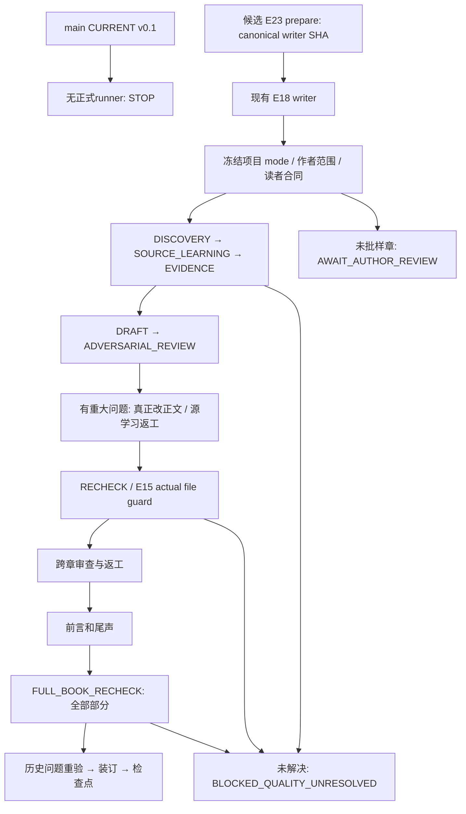

# 实际入口与候选调用链

正式main仍是v0.1规范，无active_engine；不是已运行的自动写作器。逐节点正式/候选Git blob、SHA及工作树文件身份见CALLCHAIN_AUDIT.json。其中candidate_snapshot=fcdacc1保留工程修复前后对照；worktree与quality_execution_chain是本轮最终候选源码。

KEEP允许正确正文无需改写。工程断言和定位模型意见不同；模型审稿也不等于作者或真人读者。当前固定正式入口拒绝运行候选，STABLE正向profile未执行；代码已准备真实identity/profile校验，尚待正式质量验收和作者发布决定。
